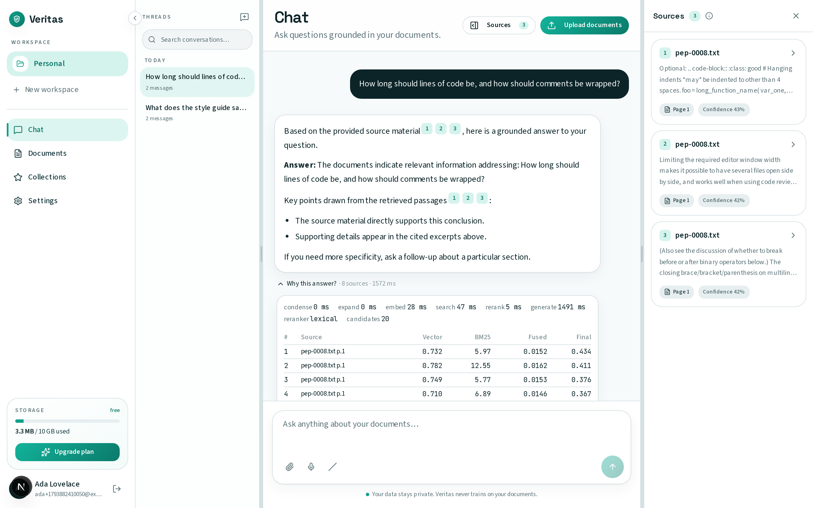
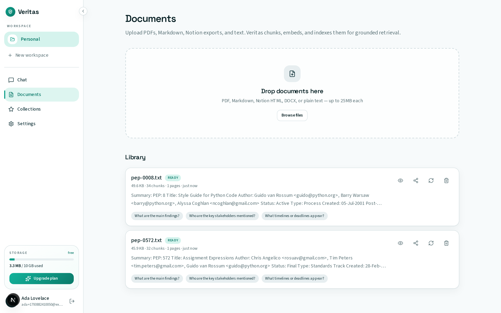
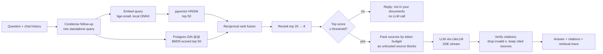

# Veritas

**Get answers, not approximations.**

Veritas is a multi-tenant "chat with your documents" app. You upload PDFs, DOCX,
Markdown, Notion exports or plain text to a workspace, ask questions, and get
streamed answers with inline citations to the passages they came from. When the
documents don't cover a question, it says so instead of guessing.

The retrieval pipeline is measured, not assumed. A small evaluation harness
runs in CI, and every default below was picked from its numbers.



*A question about two ingested PEPs: citation chips, the cited sources, and the
"Why this answer?" trace with per-stage timings and per-source scores. This
capture uses the mock LLM (no API key), so the answer text is canned; retrieval,
citations and the trace are real.*

<details>
<summary>Documents: queued ingestion, chunk counts, summaries</summary>



</details>

## Results

From [`backend/evaluation/RESULTS.md`](backend/evaluation/RESULTS.md): 41
hand-written questions (25 deliberately paraphrased) plus 6 unanswerable ones,
over 10 public-domain Python PEPs (167 chunks).

| Pipeline | R@1 | R@5 | R@10 | MRR@10 | p50 latency |
|---|---|---|---|---|---|
| Before this work: in-memory cosine + BM25 | 0.58 | 0.93 | 0.95 | 0.73 | 198 ms |
| Vector only (pgvector HNSW) | 0.39 | 0.78 | 0.88 | 0.56 | 28 ms |
| Keyword only (Postgres FTS + BM25) | 0.63 | 0.88 | 0.90 | 0.73 | 71 ms |
| Hybrid (RRF) | 0.49 | 0.85 | 0.93 | 0.64 | 83 ms |
| **Hybrid + lexical rerank (default)** | **0.63** | **0.93** | **0.95** | **0.76** | 87 ms |
| Hybrid + MS MARCO cross-encoder | 0.56 | 0.85 | 0.88 | 0.68 | 3,193 ms |

Latency as the workspace grows (one search + rerank, p50):

| Chunks | Before (in-memory) | Now (Postgres) |
|---|---|---|
| 1,000 | 263 ms | 31 ms |
| 5,000 | 1,374 ms | 73 ms |
| 20,000 | 5,780 ms | 137 ms |

CI fails a pull request if the default pipeline's R@5, R@10 or MRR drops more
than 2 points below the committed baseline.

## How a question is answered



Every answer stores a **retrieval trace**: the rewritten query, per-stage
timings, and each source's vector, BM25, fused and final scores. The UI shows it
under each answer as "Why this answer?".

Ingestion runs on a Celery worker: parse, chunk on paragraph and heading
boundaries with tiktoken counts, embed each chunk with its document title and
heading as context, then summarize. Uploads return `202` and the UI polls the job.

## Engineering decisions

Each of these came from a measurement or a failing test, not a guess.

- **Search moved into Postgres.** The previous engine loaded every chunk of a
  workspace into Python for every query (4× per question with query expansion).
  Vectors now live in a `vector(384)` column with an HNSW index. HNSW was
  chosen over IVFFlat because it needs no training step and stays accurate on a
  growing table. Filtered scans use pgvector 0.8 iterative scans, so a small
  workspace inside a large table still gets enough results.
- **BM25 instead of `ts_rank_cd`.** Postgres's built-in ranking has no IDF, so
  common words weigh as much as rare ones: keyword R@5 was 0.78. GIN still
  supplies the candidates, but they are scored with Okapi BM25 using per-term
  document frequencies from one index-backed query. Keyword R@5 went up to 0.88.
- **The cross-encoder lost.** An MS MARCO MiniLM cross-encoder was integrated
  (ONNX, no PyTorch) and evaluated. On technical documentation it scored below
  a term-coverage reranker (R@5 0.85 vs 0.93) and added about 3 s per query on
  CPU. It is still available with `RERANKER_BACKEND=cross_encoder`.
- **HyDE and multi-query are off by default.** Each adds an LLM round-trip
  before retrieval starts. They're available as flags but haven't been
  evaluated, because that needs a real LLM in CI.
- **Abstention threshold 0.20, chosen conservatively.** On the eval it keeps
  every answerable question and refuses half of the unanswerable ones. The
  best-separating value (0.28) was fit on only 6 negatives, and a wrong refusal
  costs more than a cautious answer.
- **Citations are checked after generation.** Markers that point at sources the
  model never saw are removed, and only sources the answer actually cites are
  returned and stored.
- **Integration tests on real Postgres found a real bug.** SQLAlchemy stored
  enum *names* (`FREE`) while the migrations created *values* (`free`), so every
  insert failed on a freshly migrated database. Dev databases built with
  `create_all` had hidden it. `create_all` is gone, and CI now runs
  `alembic check` for drift.
- **Running the whole stack found two more.** Two uploads ingested at the same
  time raced on a per-workspace unique key. The failed document then stayed
  `pending` forever, because the broken session couldn't record the failure.
  Entities are now upserted in a fixed order, processing runs in a savepoint,
  and both cases have tests that fail on the old code. The same run showed the
  worker forking one process per CPU, each loading the model, until it was
  killed for running out of memory, so concurrency now defaults to 2.

## Security

- Auth: [Better Auth](https://www.better-auth.com/) in Next.js issues EdDSA JWTs,
  and FastAPI verifies them against JWKS. Legacy HS256 tokens are not accepted.
- An existing account is linked to a new sign-in only when the email is verified
  and not already bound to another identity.
- Workspace roles (owner / editor / viewer) and per-document permissions are
  applied inside retrieval queries. A test discovers all 50
  `/workspaces/{id}/…` routes from the OpenAPI schema and checks that a
  non-member is refused on each.
- Redis rate limits apply to chat, uploads and auth sync, with `Retry-After` on
  429. Daily plan quotas are enforced in Postgres.
- Uploads are read in 1 MiB steps and capped (413), the declared type is checked
  against the actual bytes (415), and filenames are sanitised.
- Retrieved text goes into the prompt as untrusted `<source>` blocks.
- Production refuses to start with default secrets, `DEBUG` or the mock LLM.

## Stack

| Layer | Tech |
|---|---|
| Frontend | Next.js (App Router), React 19, Tailwind, Zustand, react-markdown |
| API | FastAPI, SQLAlchemy 2 (async), Pydantic v2, SSE streaming |
| Retrieval | Postgres 16 + pgvector 0.8 (HNSW), full-text search (GIN) + BM25, RRF |
| Models | fastembed / ONNX Runtime (`bge-small-en-v1.5`), any chat LLM via LiteLLM |
| Jobs | Celery + Redis |
| Billing | Stripe Checkout + webhooks (mock mode without keys) |

## Quick start

### Docker (everything)

```bash
cp .env.docker.example .env
cp backend/.env.example backend/.env
docker compose up --build
```

- App: http://localhost:3000
- API docs: http://localhost:8000/docs

This starts Postgres (pgvector), Redis, migrations, the API, the Celery worker
and the Next.js dev server. The embedding model is baked into the backend image.
`USE_MOCK_LLM=true` (the default) runs without any API key. Answers are then
canned text, but retrieval and citations are real.

### Choosing an LLM

Chat goes through [LiteLLM](https://docs.litellm.ai/). Set `LLM_MODEL` and the
matching key in `backend/.env`, along with `USE_MOCK_LLM=false`:

| Provider | `LLM_MODEL` | Key |
|---|---|---|
| OpenAI | `openai/gpt-4o-mini` | `OPENAI_API_KEY` |
| Anthropic | `anthropic/claude-sonnet-4-6` | `ANTHROPIC_API_KEY` |
| Google | `gemini/gemini-1.5-pro` | `GEMINI_API_KEY` |
| DeepSeek | `deepseek/deepseek-chat` | `DEEPSEEK_API_KEY` |
| GitHub Models | `github/gpt-4o-mini` | `GITHUB_API_KEY` |

Embeddings are local by default (`EMBEDDING_PROVIDER=local`, no key). To use
OpenAI instead, set `EMBEDDING_PROVIDER=openai` with
`EMBEDDING_MODEL=text-embedding-3-small`, which is shortened to 384 dimensions
to fit the vector column.

### Local development (without Docker for the apps)

```bash
docker compose up -d db redis

cd backend
cp .env.example .env
pip install -e ".[dev]"
alembic upgrade head
uvicorn app.main:app --reload --port 8000
# INGEST_INLINE=true (default) processes uploads in the API process.
# For the queued path: INGEST_INLINE=false and
#   celery -A app.tasks.celery_app.celery_app worker

cd ../frontend
cp .env.example .env.local
npm install && npm run db:push && npm run dev
```

Better Auth needs the same `INTERNAL_AUTH_BOOTSTRAP_SECRET` in `backend/.env`
and `frontend/.env.local`. Google OAuth is optional (`GOOGLE_CLIENT_ID`,
`GOOGLE_CLIENT_SECRET`, `NEXT_PUBLIC_GOOGLE_AUTH_ENABLED=true`).

### Upgrading an existing database

Migration `011` replaces the old JSON embeddings with a `vector(384)` column.
The old vectors have a different width and can't be converted, so re-embed once:

```bash
alembic upgrade head
python -m app.cli.reembed
```

Documents stay keyword-searchable until that finishes. If a dev database was
created by the old `create_all` startup and inserts fail with enum errors,
recreate it (`docker compose down -v`).

## Tests and evaluation

```bash
cd backend
pytest tests/unit                                  # no services needed
TEST_DATABASE_URL=postgresql+asyncpg://… pytest    # + integration tests on real Postgres
python -m evaluation.run                           # full retrieval comparison
python -m evaluation.bench_scale                   # latency vs workspace size
```

There are 155 backend tests. The integration tests cover search ranking and
scoping, upload → ingest → cited answer over HTTP, the SSE event sequence,
upload rejection, account linking, and the tenant-isolation sweep. CI runs
lint (ruff), types (mypy on the core packages), unit tests, migrations and
`alembic check`, integration tests, the retrieval eval gate, and the frontend's
eslint, `tsc` and build.

## Project layout

```
backend/
  app/api/            FastAPI routes, auth + role dependencies, rate limiting
  app/services/       retrieval/, llm/ (orchestrator), ingestion/, identity/, billing/ …
  app/tasks/          Celery tasks (ingestion, webhooks, cleanup)
  app/db/migrations/  Alembic (011 = pgvector + full-text search)
  evaluation/         corpus, questions, eval runner, scale benchmark, results
  tests/              unit/ and integration/ (real Postgres)
frontend/src/         Next.js app (chat, documents, collections, settings)
docs/                 SCHEMA.md (data model), screenshots/
```

## Limitations and next steps

- The eval covers retrieval on 41 questions in one domain, so small differences
  are noise. Answer faithfulness (an LLM judge) isn't measured yet, and neither
  are HyDE and multi-query.
- Keyword candidate ranking still grows with how many chunks match common
  terms (20× more data costs 4.4× more time).
- SSO and retention policies exist as configuration endpoints only; there is no
  IdP login flow.
- There are no frontend tests or end-to-end browser tests yet.
- Migration downgrades below `011` are broken; only upgrades are checked in CI.

## License

MIT
