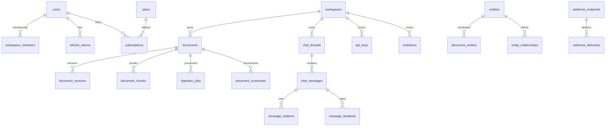

# Veritas PostgreSQL Schema

**Get answers, not approximations** — schema designed for multi-tenant RAG at 3NF+.

Total tables: **40** (9 legacy cores retained + 31 additive).  
Migrations: `backend/app/db/migrations/versions/001`–`007` (one logical domain each).

---

## Existing vs added

### Already existed (kept, additive columns only)

| Table | Notes |
|-------|-------|
| `users` | + `deleted_at`, `avatar_url`, `last_login_at`. Legacy `plan` / Stripe / `queries_today` kept until breaking cleanup. |
| `workspaces` | + `deleted_at`. FK `owner_id` → RESTRICT. |
| `workspace_members` | Unchanged role join table. |
| `documents` | + `deleted_at`, `active_version_id`. Legacy `summary` / `suggested_questions` JSON kept. |
| `document_chunks` | + `document_version_id`, `embedding_model_id`. Embedding **stays on-row**. |
| `chat_threads` | + `deleted_at`. |
| `chat_messages` | Role is ENUM; legacy `citations` / `feedback` JSON/string kept. |
| `usage_events` | Append-only ledger (same name as before). |
| `audit_logs` | Indexes added; append-only. |

### New tables (31)

See domain sections below.

---

## Soft delete policy

| Soft delete (`deleted_at`) | Why |
|----------------------------|-----|
| users, workspaces, documents, collections, chat_threads, invitations, api_keys, webhook_endpoints, sso_connections, shared_links | Recoverable; GDPR export before hard purge |
| **Hard delete / append-only** | Why |
| chunks, versions, messages, citations, feedback, usage_*, audit_logs, login_history, jobs, graph tables, deliveries | Owned children CASCADE; ledgers never mutate |

---

## Deliberate denormalizations

1. **`usage_meters`** ← rolled-up `usage_events` for O(1) quota checks  
2. **`documents.chunk_count` / `page_count`** ← avoid COUNT on list views  
3. **`users.plan` / Stripe IDs / `queries_today`** ← **legacy**; source of truth is `subscriptions` + `usage_meters` / `plans`

**Not created:** `document_chunk_embeddings` (single model at a time; use `embedding_models` + FK).  
**Not created:** `embedding_jobs` (folded into `ingestion_jobs.stage`).

---

## Domain groups

### 1. Identity & Access (`001_identity`)

| Table | Purpose | Feature |
|-------|---------|---------|
| users | Auth + profile | Login/register |
| workspaces | Tenant boundary | Multi-tenancy |
| workspace_members | User↔workspace↔role | Owner/Editor/Viewer |
| invitations | Pending email invites + expiring tokens | Collaboration |
| refresh_tokens | Rotating hashed refresh tokens | Session security |
| api_keys | Workspace-scoped hashed keys + scopes | Programmatic API |

### 2. Documents & Ingestion (`002_documents`)

| Table | Purpose | Feature |
|-------|---------|---------|
| embedding_models | Provider/dim registry | Model migration without splitting embeddings |
| documents | Logical document identity | Upload/list |
| document_versions | Re-upload history; one active | Versioning |
| document_chunks | Semantic chunks + embedding | Hybrid retrieval |
| document_summaries | Auto summaries | Previews / retriever hints |
| suggested_questions | LLM questions per doc | Onboarding prompts |
| document_permissions | Page/section ACL | Enterprise ACL |
| collections | Curated doc sets | Collections UI |
| collection_documents | Collection membership | Collections UI |
| ingestion_jobs | Celery parse→embed status | Async ingestion |

### 3. Knowledge Graph (`003_knowledge_graph`)

| Table | Purpose | Feature |
|-------|---------|---------|
| entities | People/dates/concepts | Document intelligence |
| document_entities | Mentions + offsets | “Who appears where?” |
| entity_relationships | Graph edges | “Who worked with Y?” |

### 4. Chat (`004_chat`)

| Table | Purpose | Feature |
|-------|---------|---------|
| chat_threads | Conversations | Chat UI |
| chat_thread_documents | Optional retrieval scope | Doc-scoped chat |
| chat_messages | Turns | Streaming Q&A |
| message_citations | Queryable evidence links | Citations / analytics |
| message_feedback | Thumbs + comment | Reranker tuning |
| thread_comments | Team discussion | Shared threads |

### 5. Billing (`005_billing`)

| Table | Purpose | Feature |
|-------|---------|---------|
| plans | Quotas/prices as data | Monetization |
| subscriptions | Stripe sub + period | Checkout/webhooks |
| usage_events | Append-only ledger | Metering |
| usage_meters | Period counters (denorm) | Fast quota checks |
| invoices | Local Stripe invoice history | Billing UI |

### 6. Audit & Notifications (`006_audit_notifications`)

| Table | Purpose | Feature |
|-------|---------|---------|
| audit_logs | Compliance actions | GDPR/CCPA |
| login_history | High-volume auth events | Security review (separate retention) |
| notifications | In-app feed | Ingest done, invites, billing |
| notification_preferences | Channel toggles | User settings |

### 7. Enterprise extras (`007_enterprise`)

| Table | Purpose | Feature |
|-------|---------|---------|
| webhook_endpoints | Outbound event URLs | Integrations |
| webhook_deliveries | Delivery attempts/retries | Webhook debug |
| sso_connections | OIDC/SAML config | Enterprise SSO |
| data_retention_policies | Per-resource retain_days | Compliance |
| export_jobs | GDPR / workspace exports | Data portability |
| shared_links | Expiring public links | Share thread/doc/collection |

---

## ERD (high level)



---

## Apply migrations

```bash
cd backend
# Postgres with pgcrypto (UUID) — docker compose db image is fine
alembic upgrade head
```

Dev still supports `Base.metadata.create_all()` on startup for empty DBs; prefer Alembic for real environments.

---

## Model layout

```
app/models/domain/
  base.py           enums + mixins
  identity.py
  documents.py      (+ graph + ingestion_jobs + collections)
  chat.py
  billing.py
  audit.py
  notifications.py
  enterprise.py
  __init__.py       re-exports (backward compatible)
```

Pydantic: `app/models/schemas/__init__.py` (core) + `extended.py` (new API shapes).
